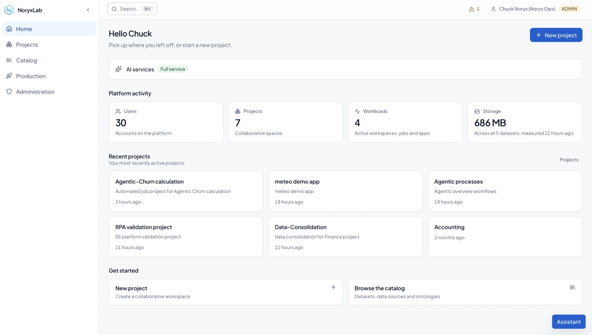

<p align="center">
  
</p>

<h1 align="center">NoryxLab Community Edition</h1>

<p align="center">
  The open source data science platform that stays on your infrastructure.
</p>

<p align="center">
  <a href="https://github.com/Noryxlab/NoryxLab-CE/actions/workflows/ci.yml"></a>
  <a href="LICENSE"></a>
  <a href="docs/INSTALL_CE.md"></a>
  <a href="https://www.noryxlab.ai/docs/"></a>
</p>

<p align="center">
  <a href="https://www.noryxlab.ai/">noryxlab.ai</a> ·
  <a href="https://www.noryxlab.ai/platform.html">How the platform works</a> ·
  <a href="docs/INSTALL_CE.md">Install</a> ·
  <a href="docs/API.md">API</a> ·
  <a href="docs/EDITIONS.md">Editions</a>
</p>

NoryxLab is a Kubernetes-native data science and AI platform. It gives Python
and R teams self-service workspaces (JupyterLab, VS Code, RStudio), batch and
scheduled jobs, deployed applications and S3 datasets, organised by project,
on a cluster you operate. Your data stays in your object storage, your users
in your identity provider, your images in your registry; the platform's own
database holds metadata and nothing that could not be rebuilt from your
systems and a backup.

The Community Edition is the whole core workflow, under MPL-2.0. The
Enterprise Edition adds what an institution asks for around the same platform:
an RBAC matrix, audit, controlled egress, regulated datasets read in place and
never downloaded, backups with rehearsed restores, continuous validation and a
governed AI assistant. Nothing in this repository is a disabled Enterprise
feature waiting for a key.

<p align="center">
  
</p>

<p align="center"><sub>Captured on a running installation. More screens: the <a href="docs/screenshots/project-overview.webp">project overview with measured consumption</a>, a <a href="docs/screenshots/workspace-assistant.webp">VS Code workspace with the integrated assistant</a>, and the <a href="docs/screenshots/access-matrix.webp">access matrix</a>.</sub></p>

> **Project status:** actively developed and in production at several
> installations. Test upgrades on a representative non-production cluster
> before production use.

## Start Here

| I want to... | Start here |
| --- | --- |
| Install NoryxLab Community Edition | [Step-by-step installation guide](docs/INSTALL_CE.md) |
| Understand infrastructure requirements | [Infrastructure prerequisites](docs/INFRA_PREREQUISITES.md) |
| Use the platform as a data practitioner | [Projects](docs/PROJECTS.md), [datasets](docs/S3_DATASET_MOUNTS.md), [bulk clinical imports](docs/DATASET_BULK_IMPORT.md) and [workspaces](docs/WORKSPACES.md) |
| Understand project agents and workflows | [Agent model and Enterprise runtime](docs/AGENTS.md) |
| Integrate with the REST API | [API contract](docs/API.md) and the running platform's `/swagger` |
| Operate or troubleshoot a deployment | [Operations guides](#operations) |
| Contribute code | [Developer quick start](#developer-quick-start) and [contribution rules](#contributing) |

## What You Can Build

| Area | Community Edition capabilities |
| --- | --- |
| **Projects** | Collaborative projects, members, roles, Git repositories, secrets and data connections |
| **Data** | S3-compatible datasets mounted directly into workloads, data sources and semantic catalog foundations |
| **Environments** | Curated or custom Docker environments for Jupyter, VS Code and RStudio |
| **Compute** | Interactive workspaces, one-off jobs, scheduled jobs and named hardware tiers |
| **Production** | Project applications, lifecycle operations and authenticated access routes |
| **Identity** | Keycloak OIDC authentication and project-level access control |
| **Integration** | Versioned REST API, public OpenAPI contract and Swagger UI |

## Architecture

```text
Users
  |
  v
Noryx frontend  --->  Noryx API  ---> PostgreSQL
       |                  |
       |                  +-------> Keycloak (OIDC)
       |                  +-------> S3-compatible storage
       |                  +-------> Kubernetes API
       |
       +-- projects, datasets, environments, workspaces, jobs, apps

Kubernetes workloads
  |- workspaces (Jupyter, VS Code, RStudio)
  |- jobs and scheduled jobs
  `- published applications
```

The control plane runs in Kubernetes. User workloads run as standard
Kubernetes resources in a separate workload namespace. Harbor and the image
build service are external components in the reference topology.

## Community And Enterprise

Both editions run the same control plane, the same object model and the same
API. Moving from one to the other replaces an image; it does not migrate data
or re-teach a workflow.

| Capability | Community | Enterprise |
| --- | --- | --- |
| Projects, organisations, roles | Included | Included |
| Workspaces, jobs, scheduled jobs, applications | Included | Included |
| Environments and in-cluster builds | Included | Included |
| S3 datasets, data services, repositories, secrets | Included | Included |
| Quotas and usage accounting | Included | Included |
| Full API and Swagger UI | Included | Included |
| Audit trail | Platform events | Advanced audit, CSV export |
| Access model | Fixed roles: viewer, editor, admin | Custom RBAC matrix |
| Outbound network access | Cluster policy | Controlled egress, requested and decided |
| Regulated (HDS) datasets | — | Restricted download, audited reads |
| Agent runtime, tools, workflow scheduler | — | Included, with governance and export |
| Backups, restore, API tokens | — | Scheduled, off-site, rehearsed |
| Continuous platform validation | — | Scheduled suites and alerting |
| In-platform assistant | — | Included, OpenAI-compatible API |
| Support | Issues on GitHub | Commercial agreement |

The Enterprise Edition is an overlay compiled into its own binary: an
enterprise capability is absent from the Community binary rather than present
and disabled. Enterprise licensing and commercial enquiries:
[admin@noryxlab.ai](mailto:admin@noryxlab.ai).

- [Edition model](docs/EDITIONS.md)
- [CE/EE extension boundary](docs/EE_EXTENSION_POINTS.md)

## Install Community Edition

The installation guide takes a new Kubernetes installation to a usable CE
baseline: OIDC login, projects, datasets, workspaces, jobs and applications.
It explicitly separates repository defaults from installation-specific values
and ends with a smoke test and a complete first-user journey.

1. Read the [step-by-step CE installation guide](docs/INSTALL_CE.md).
2. Prepare the [cluster, registry, DNS and storage prerequisites](docs/INFRA_PREREQUISITES.md).
3. Render a private installation overlay and run
   `./scripts/ops/validate-installation-manifest.sh` before applying it.
4. Bootstrap and harden [Keycloak](docs/KEYCLOAK_SETUP.md).
5. Run the deployment smoke test and validate the first user journey.

The manifests in `deploy/k8s/base` are reference values, not a production
command to run unchanged. They deliberately contain example registry and
domain names, placeholder backup images and demonstration secrets. Keep all
installation values in a private operations repository or secret manager.

## Documentation

### Build And Use

- [Projects](docs/PROJECTS.md)
- [Datasets and direct S3 mounts](docs/S3_DATASET_MOUNTS.md)
- [Bulk dataset import from an external machine](docs/DATASET_BULK_IMPORT.md)
- [Data sources](docs/DATASOURCES_V1.md)
- [Semantic catalog and ontology foundations](docs/ONTOLOGY.md)
- [Using ontologies](docs/USING_ONTOLOGIES.md) and [using extracts](docs/USING_EXTRACTS.md) — the guides for the screens
- [Pushing data into a dataset](docs/PUSHING_TO_A_DATASET.md) — one page for an external sender
- [Environments](docs/ENVIRONMENTS.md)
- [Workspaces](docs/WORKSPACES.md) and [workspace filesystem layout](docs/WORKSPACE_FILESYSTEM_LAYOUT.md)
- [Jobs and history](docs/JOB_HISTORY.md) and [scheduled jobs](docs/SCHEDULED_JOBS.md)
- [Applications and Production](docs/APPS_V1.md) and [production operations](docs/PRODUCTION.md)
- [Hardware tiers](docs/HARDWARE_TIERS.md)
- [Agents, teams and workflows](docs/AGENTS.md) (public model; Enterprise runtime)

### Identity, Security And API

- [Keycloak setup](docs/KEYCLOAK_SETUP.md)
- [RBAC model](docs/RBAC_MODEL.md)
- [Organisations](docs/ORGANIZATIONS.md)
- [Credentials and Git access](docs/CREDENTIALS.md)
- [Workload network isolation](docs/WORKLOAD_NETWORK_ISOLATION.md)
- [Supported API contract](docs/API.md)
- [Backend runtime API](docs/BACKEND_RUNTIME_API.md)

### Operations

- [Install Community Edition step by step](docs/INSTALL_CE.md)
- [Bootstrap a VM](docs/BOOTSTRAP_VM.md)
- [Image security and Harbor mirroring](docs/IMAGE_SECURITY.md)
- [Observability](docs/OBSERVABILITY.md)
- [Recovery](docs/RECOVERY.md)
- [Platform data and secrets](docs/PLATFORM_DATA_AND_SECRETS.md)
- [Workspace troubleshooting](docs/WORKSPACE_TROUBLESHOOTING.md)
- [Mail bridge](docs/MAIL.md)

## Developer Quick Start

Prerequisites:

- Go `1.25`
- Node.js `22` and npm
- PostgreSQL `16` for database-backed backend tests

Run the API in local development mode:

```bash
git clone https://github.com/Noryxlab/NoryxLab-CE.git
cd NoryxLab-CE
go -C backend run ./cmd/noryx-api
```

The local API exposes `/healthz` and Swagger at `/swagger`. Local development
uses the in-memory store unless PostgreSQL configuration is supplied. Do not
enable header authentication outside a local development environment.

Run the frontend in a second terminal:

```bash
npm --prefix frontend ci
npm --prefix frontend run dev
```

Run the main quality checks before submitting a change:

```bash
go -C backend vet ./...
go -C backend test ./...
npm --prefix frontend run typecheck
npm --prefix frontend run lint
npm --prefix frontend run test
npm --prefix frontend run build
./scripts/check-edition-boundary.sh
```

GitHub Actions scans the complete Git history for secrets, checks reachable Go
vulnerabilities and production npm dependencies, validates Kubernetes
configuration and scans the two built container images. It also boots the CE
manifests in an isolated Kind cluster and checks the backend health endpoint.

## API

The running platform exposes:

- `/swagger`: supported public API
- `/swagger/openapi.public.yaml`: supported OpenAPI contract
- `/swagger?spec=full`: implementation inventory, including internal UI routes
  without compatibility guarantees

The API is versioned under `/api/v1`. CI checks that the OpenAPI documents stay
in sync with the router. Read the [API documentation](docs/API.md) before
integrating a client.

## Contributing

Contributions are welcome. Before opening a pull request:

1. Keep CE source independent from Enterprise source code.
2. Add or update tests for behavioural changes.
3. Run the quality checks above.
4. Regenerate the supported API document when changing a public route:

   ```bash
   python3 scripts/ops/generate-openapi.py
   ```

5. Describe the user-facing impact and deployment implications in the pull
   request.

For security-sensitive issues, do not publish credentials, customer data or
exploit details in a public issue. Contact the maintainers privately first.

## License

NoryxLab Community Edition is licensed under the
[Mozilla Public License 2.0](LICENSE) (`MPL-2.0`). The MPL applies at file
level: modifications to MPL-covered files remain under MPL-2.0 when
distributed, while separate files can be combined with the Community Edition as
part of a larger work under different terms.
